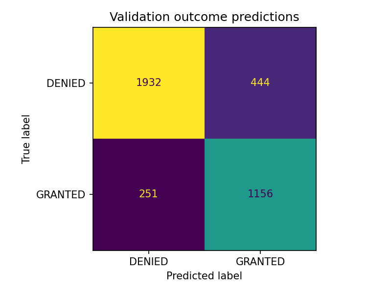
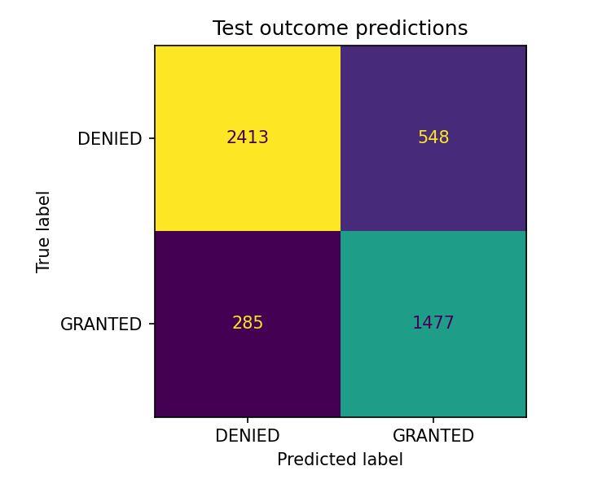

# Outcome classification baseline

Generated: 2026-10-27T21:44:14.888039+00:00

Binary TF-IDF + Logistic Regression baseline for stored DOHA hearing outcomes.

## Data and exclusions

Source rows: **33,610**. Included rows: **23,626**.

| Disposition | Rows |
|---|---:|
| included | 23,626 |
| non_hearing | 3,339 |
| non_binary_outcome | 3,093 |
| appeal_document | 1,892 |
| no_findings_heading | 1,627 |
| duplicate_model_text | 28 |
| no_safe_section_end | 4 |
| facts_too_short | 1 |

Only bounded Findings of Fact sections are used. No whole-document fallback. Explicit clearance-verdict sentences are filtered. Stored labels are not independently adjudicated.

## Split design

First fold of seeded StratifiedGroupKFold(5), then first fold on development with seed+1; approximate 64/16/20. No fold selection by performance.

Connected components of normalized case number, full document hash and factual input hash; remove identical factual inputs and ambiguous duplicate labels.

| Partition | DENIED | GRANTED | Total |
|---|---:|---:|---:|
| train | 9,581 | 5,539 | 15,120 |
| validation | 2,376 | 1,407 | 3,783 |
| test | 2,961 | 1,762 | 4,723 |

Assertions verify no group, normalized document, or normalized model text crosses partitions. The vectorizer sees training text only.

## Held-out results

| Partition | Model | Accuracy | Macro F1 | Micro F1 | ROC AUC (GRANTED) |
|---|---|---:|---:|---:|---:|
| validation | logistic_regression | 0.8163 | 0.8082 | 0.8163 | 0.8962 |
| validation | majority_class | 0.6281 | 0.3858 | 0.6281 | 0.5000 |
| test | logistic_regression | 0.8236 | 0.8164 | 0.8236 | 0.9089 |
| test | majority_class | 0.6269 | 0.3853 | 0.6269 | 0.5000 |

Micro F1 equals accuracy for this single-label task. No parameters were selected using test performance.

### Validation per-class metrics

| Outcome | Precision | Recall | F1 | Support |
|---|---:|---:|---:|---:|
| DENIED | 0.8850 | 0.8131 | 0.8476 | 2,376 |
| GRANTED | 0.7225 | 0.8216 | 0.7689 | 1,407 |



### Test per-class metrics

| Outcome | Precision | Recall | F1 | Support |
|---|---:|---:|---:|---:|
| DENIED | 0.8944 | 0.8149 | 0.8528 | 2,961 |
| GRANTED | 0.7294 | 0.8383 | 0.7800 | 1,762 |



## Limits and error review

- This predicts historical stored labels, not legal eligibility or an adjudicator's future decision. Source outcome extraction can be wrong.
- Findings are written after adjudication; section extraction and sentence filtering reduce direct leakage but do not prove a prospective or leakage-free evaluation.
- Review a manually labeled sample of section boundaries, source outcomes, and model errors before relying on the scores. No completed human audit is claimed.
- Strict section rules exclude many cases. Reported scores apply only to the retained hearing subset; no appeal, multiclass, guideline-classification, or fairness performance is established.
- Partitions are grouped random splits, not future-year validation. Unknown links between cases and near-duplicate documents may remain.
- Probabilities are uncalibrated; do not treat them as validated confidence in clearance eligibility.
- Inspect `top_features.json` for shortcuts and the local `validation_predictions.csv` for errors. Test predictions are for final reporting; avoid iterating on the test set.

## Reproduce

```bash
python -m src.train_outcome
```

Model, manifests, row audit and per-case predictions are kept under ignored `data/processed/classifier/`. This report contains aggregate results only.

Split manifest SHA-256: `9533f6afbaa4045c5579a45c3c7f02948ad141302010fceac62d165e95fef1c8`
